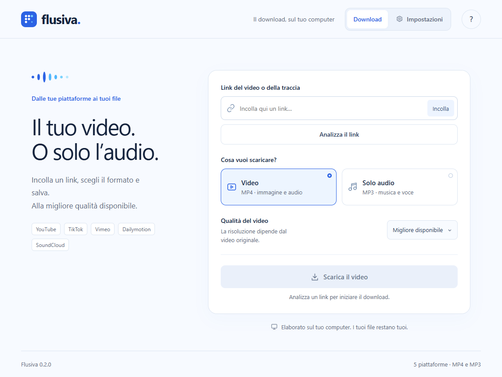
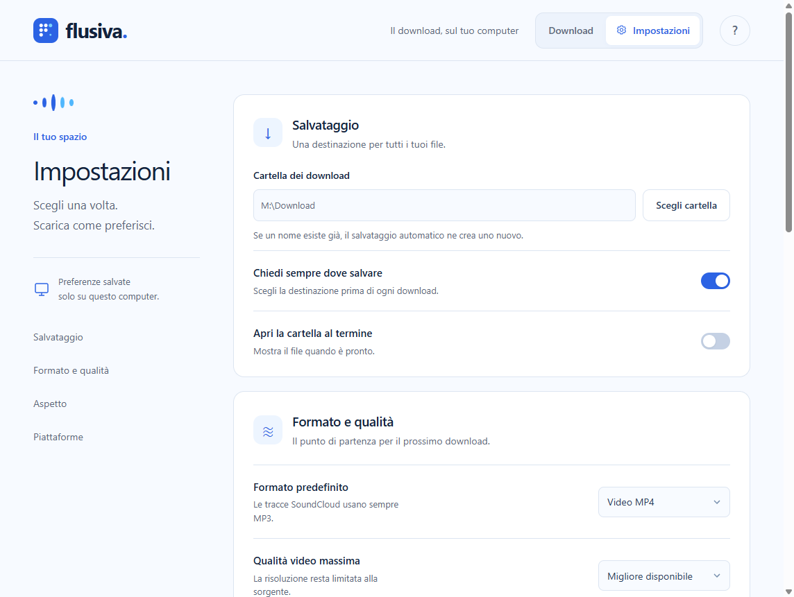
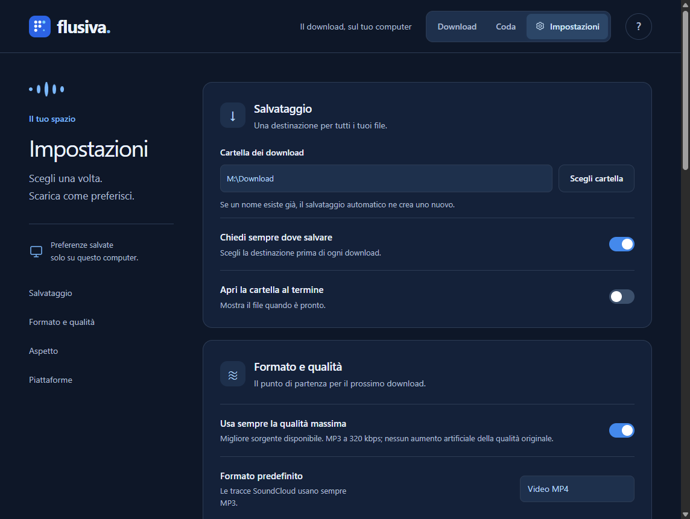

# Flusiva


App desktop per scaricare **video MP4 e audio MP3 da YouTube, TikTok, Vimeo, Dailymotion e SoundCloud**, con interfaccia in italiano. Windows, Linux e macOS (Intel e Apple Silicon). Il computer dell'utente esegue download e conversione: nessun server remoto, account, hosting o database.



## Scaricare l'app

Gli installer sono nella sezione [Releases](https://github.com/CosmoNetinfo/flusiva/releases). Dopo ogni push su `main`, GitHub Actions genera anche gli artifact scaricabili dalla scheda [Actions](https://github.com/CosmoNetinfo/flusiva/actions).

| Sistema | File |
| --- | --- |
| Windows 10/11 x64 | Installer `.exe` |
| Linux x64 | `.AppImage` oppure pacchetto Debian/Ubuntu `.deb` |
| macOS Intel | `.dmg` / `.zip` con `x64` nel nome |
| macOS Apple Silicon | `.dmg` / `.zip` con `arm64` nel nome |

Le prime build non sono firmate né notarizzate. Windows e macOS possono mostrare avvisi sull'editore. Una distribuzione con firma richiede certificati del proprietario. Non è configurato un aggiornamento automatico: installare le nuove release per aggiornare anche yt-dlp.

Su Windows eseguire l’installer e scegliere la cartella. Su macOS aprire il DMG e trascinare Flusiva in Applicazioni; selezionare la variante adatta in **Informazioni su questo Mac**. Le build sono separate: `arm64` per chip Apple, `x64` per Intel. Verificare l’origine dalla repository ufficiale e il checksum della release prima di autorizzare un’app non firmata. Requisiti macOS ed Electron: [supporto delle piattaforme](https://www.electronjs.org/docs/latest/tutorial/support#supported-platforms).

Su Linux: rendere eseguibile l'AppImage (`chmod +x Flusiva-*.AppImage`) e avviarla; se FUSE non è disponibile usare il `.deb` o `--appimage-extract-and-run`. Non eseguire l'app come root e non disabilitare la sandbox.

## Utilizzo

1. Incollare il link di un singolo video o di una traccia e scegliere **Analizza il link**.
2. Selezionare **Video MP4** o **Solo audio MP3** e la qualità.
3. Premere **Scarica** e scegliere dove salvare il file.

Video: migliore combinazione di tracce MP4/M4A disponibile, senza ricodifica del video. Risoluzioni fino a 8K se fornite dalla sorgente; i codec più recenti possono richiedere un lettore aggiornato. MP3: 128, 192, 256 o 320 kbps, partendo dal migliore audio disponibile. La conversione MP3 è con perdita e non può aumentare la qualità della sorgente.

Un download alla volta, durata massima 6 ore, limite 8 GiB per singola traccia, timeout 2 ore. I file vengono preparati nello spazio temporaneo del sistema, copiati alla destinazione e rimossi al termine, in caso di errore o annullamento. Serve spazio per tracce, file finale e copia di salvataggio. Una chiusura forzata del processo può lasciare una cartella `flusiva-*` nella directory temporanea: si può rimuovere quando l'app è chiusa.

Dirette in corso/programmate, playlist, video privati e contenuti che richiedono login non sono supportati. Le piattaforme possono cambiare o bloccare le richieste: nessuna app può garantire il download di ogni contenuto. Usare contenuti propri o autorizzati.

## Piattaforme

| Piattaforma | Link accettati | Output |
| --- | --- | --- |
| YouTube | Video, Shorts, YouTube Music, `youtu.be` | MP4 e MP3 |
| TikTok | Singolo video pubblico, `vm.tiktok.com`, `vt.tiktok.com`, `tiktok.com/t/` | MP4 e MP3 |
| Vimeo | `vimeo.com/ID` e `player.vimeo.com/video/ID` pubblici | MP4 e MP3 |
| Dailymotion | Singolo video, embed e `dai.ly` | MP4 e MP3 |
| SoundCloud | Singola traccia pubblica e link brevi `on.soundcloud.com` | MP3 |

Per SoundCloud viene selezionato MP3 e MP4 resta disabilitato. I link brevi sono risolti con controllo di ogni redirect, della piattaforma e del numero di passaggi. Le copertine sono accettate soltanto dai CDN delle piattaforme; se non disponibili viene mostrato il simbolo Flusiva.

**Disponibilità:** nelle prove online del 24 novembre 2026 sono riusciti i download MP4 e MP3 da YouTube e Dailymotion e il download MP3 da SoundCloud, con tracce verificate tramite FFprobe e pulizia dei temporanei. Le richieste di prova a TikTok e Vimeo sono state limitate o hanno richiesto accesso: il loro supporto è implementato, ma non è stato verificato un download riuscito in questa sessione. Il funzionamento dipende da contenuto, rete e restrizioni della piattaforma. [Valutazione e verifiche](docs/PLATFORMS.md).

## Impostazioni

Aprire **Impostazioni** nella barra superiore. Le modifiche entrano in vigore con **Salva preferenze**; il tema viene mostrato in anteprima mentre lo si sceglie.

* **Cartella dei download:** selettore nativo del sistema; nessun percorso deve essere digitato.
* **Chiedi sempre dove salvare:** attivo per impostazione iniziale. Disattivandolo, l'app usa la cartella scelta e aggiunge `(1)`, `(2)` e così via ai nomi già presenti, senza sovrascriverli.
* **Apri la cartella al termine:** facoltativo, mostra il file appena pronto.
* **Formato e qualità predefiniti:** MP4 o MP3, risoluzione massima e bitrate MP3. Il singolo download può usare una scelta diversa.
* **Aspetto:** tema chiaro, scuro o di sistema, con opzione per ridurre le animazioni. Viene rispettata anche la preferenza di movimento del sistema.
* **Piattaforme e versione:** riepilogo dei formati, motore incluso e collegamento alle release ufficiali.
* **Ripristina preferenze:** torna ai valori iniziali; non elimina i file scaricati.

Le preferenze sono in `settings.json` nella cartella dati dell’app (`app.getPath('userData')`), con scrittura atomica. Nessun database o sincronizzazione online. Un file corrotto viene recuperato con valori iniziali. Le impostazioni scelte durante un download si applicano a quelli successivi.





## Sviluppo

Richiede Node.js 24 LTS e Git. Python e FFmpeg di sistema non servono: i binari vengono preparati per la piattaforma corrente.

```sh
npm ci --ignore-scripts
npm run setup
npm start
```

`prepare:tools` scarica yt-dlp dalla release ufficiale fissata nel sorgente e ne verifica SHA-256. Copia FFmpeg e FFprobe dai pacchetti npm e include le licenze. Il runtime JavaScript usato da yt-dlp è Node incluso in Electron (`ELECTRON_RUN_AS_NODE=1`), quindi non serve installare Deno.

```sh
npm run check
npm test
npm run pack
npm run dist
```

Test online facoltativo: `node scripts/online-smoke.cjs`. Scarica il cortometraggio Creative Commons Big Buck Bunny della Blender Foundation in MP4 a risoluzione limitata e MP3, verifica le tracce con FFprobe e rimuove i temporanei. Richiede Internet e circa 70 MB di trasferimento; un URL alternativo autorizzato può essere passato come argomento. Per un contenuto solo audio viene verificato soltanto MP3. Non fa parte della CI per evitare dipendenza dai servizi esterni nei controlli deterministici.

Sonde dei soli metadati: `node scripts/platform-smoke.cjs`. Controlla contenuti pubblici sulle cinque piattaforme senza scaricare i file multimediali e registra esiti e restrizioni in `test-results/platform-probes.json`. Un blocco remoto viene registrato come tale, non come successo.

Compilare sul sistema di destinazione. GitHub Actions esegue automaticamente i controlli, il test d'avvio Electron e la compilazione su quattro runner nativi. I 19 test deterministici non contattano i servizi esterni. Il test Electron verifica anche navigazione, preferenze via IPC, rifiuto di valori non validi, ripristino e presenza delle cinque piattaforme, con profilo isolato. Prima di una release pubblica verificare un download MP4 e MP3 reale su ciascun sistema con un video autorizzato.

Per pubblicare gli installer creare e inviare un tag coerente con `package.json`:

```sh
git tag v0.2.0
git push origin v0.2.0
```

Il workflow pubblica una GitHub Release solo quando tutte e quattro le build riescono. Include `SHA256SUMS.txt`. Nessun workflow Pages è necessario.

## Architettura

* `desktop/`: processo Electron e bridge IPC ristretto, renderer in sandbox con isolamento del contesto, navigazione e permessi bloccati.
* `public/`: interfaccia locale HTML/CSS/JavaScript con CSP, senza script remoti, telemetria o server HTTP.
* `core/platforms.cjs`: riconoscimento dei cinque servizi, link brevi, metadati comuni e opzioni dei formati.
* `core/settings.cjs` e `core/files.cjs`: preferenze locali validate, aggiornamenti atomici e salvataggio senza sovrascrittura.
* `core/`: processi senza shell, avanzamento, annullamento e pulizia dei temporanei.
* `scripts/prepare-tools.mjs`: dipendenze native e controllo di integrità.
* `.github/workflows/build.yml`: test, installer e pubblicazione release.

Copertine e contenuti sono richiesti direttamente alle piattaforme e ai loro CDN. Nessun link viene inviato a un servizio Flusiva. La pagina Impostazioni non genera richieste di rete; il collegamento alle release si apre nel browser soltanto al clic.

Licenze dei componenti in [THIRD_PARTY_NOTICES.md](THIRD_PARTY_NOTICES.md).

## Logo, grafica e prossimi sviluppi

Identità in blu, azzurro e bianco, con una F costruita da puntini. [Studio del logo e tre proposte](docs/BRAND.md), [tavola ad alta risoluzione](docs/brand/logo-study.png), [roadmap e piattaforme candidate](docs/ROADMAP.md), [note di rilascio](CHANGELOG.md) e [verifiche della versione](docs/VALIDATION.md).

La versione 0.2.0 implementa TikTok, Vimeo, Dailymotion e SoundCloud. La roadmap mantiene Instagram, firma digitale, aggiornamenti verificati e coda di download fra le evoluzioni future.

## Risolvere un problema

| Problema | Cosa verificare |
| --- | --- |
| YouTube richiede accesso o blocca la richiesta | Riprovare più tardi e verificare le nuove release. Flusiva non importa cookie né credenziali del browser |
| MP4 non disponibile | Scegliere la migliore qualità disponibile oppure MP3; i formati dipendono dal video |
| Video senza riproduzione nel lettore di sistema | I file possono usare AV1/VP9/H.264 secondo la sorgente; usare un lettore aggiornato. MP4 è un contenitore, non una garanzia sul codec |
| Download o conversione lenti | Dipendono da Internet, dimensione del file e computer. La fase di conversione non mostra una percentuale inventata |
| Spazio su disco esaurito | Liberare spazio nella cartella temporanea del sistema e nella destinazione |
| AppImage non si avvia | Verificare FUSE e i permessi, oppure usare il pacchetto `.deb`. Se il sistema impedisce la sandbox Chromium, preferire il pacchetto installato e non usare `--no-sandbox` |
| Antivirus o Gatekeeper mostrano un avviso | Le prime release sono prive di firma dell’editore; verificare provenienza e checksum. La firma è prevista in roadmap |

Per una segnalazione aprire una [issue](https://github.com/CosmoNetinfo/flusiva/issues) con sistema, architettura, versione e messaggio di errore. Non allegare cookie, password o link privati. Per i formati, indicare un video pubblico che si ha il permesso di utilizzare.
