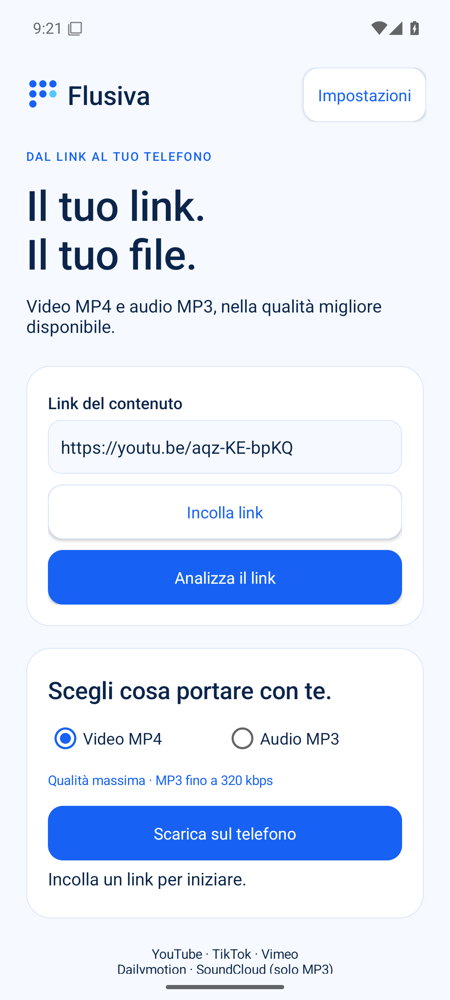
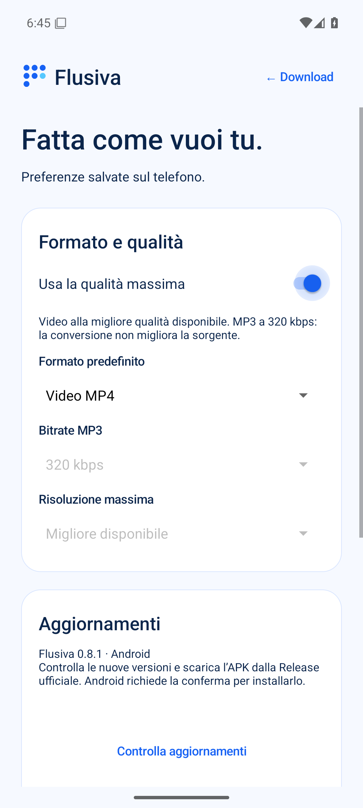
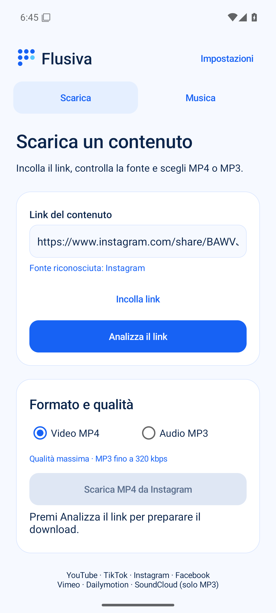
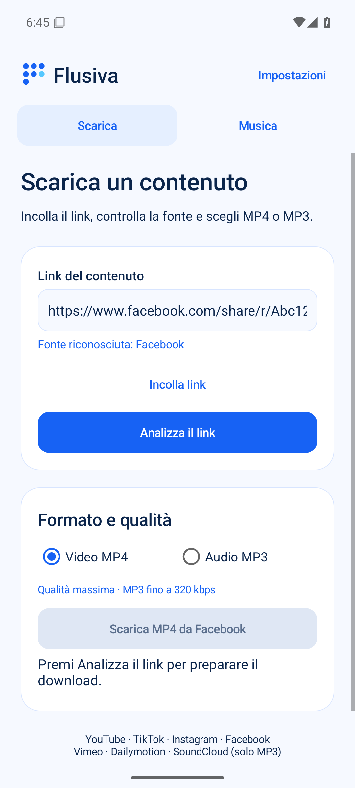
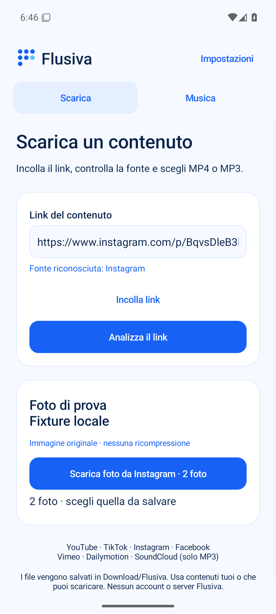

# Flusiva per Android

App nativa Kotlin per **Android 10 o successivi**, con elaborazione sul telefono. APK universale per ARM64, ARMv7 e x86_64; include Python, yt-dlp 2026.11.23, QuickJS e FFmpeg. Non richiede Termux, un computer acceso, account o server Flusiva.

<p> </p>

## Installazione e uso

Dalla 0.7 la pagina **Scarica** è separata da **Musica**. La fonte viene riconosciuta dal link e mostrata prima del download; il pulsante indica formato e piattaforma, per esempio **Scarica MP3 da YouTube**. La sezione Musica ha pagine distinte **Lettore**, **Playlist** e **Audio**.

Scaricare `Flusiva-VERSIONE-android.apk` dalle [Release ufficiali](https://github.com/CosmoNetinfo/flusiva/releases). Aprire l’APK dal browser o dal gestore file e consentire l’installazione da quella sorgente quando Android lo richiede. L’app non è pubblicata sul Play Store.

1. Incollare un singolo link, oppure scegliere **Condividi → Flusiva** nell’app della piattaforma.
2. Premere **Analizza il link**, scegliere Video MP4 o Audio MP3 e **Scarica sul telefono**.
3. Il file viene salvato in **Download/Flusiva**. Si può aprire o condividere dall’app.

YouTube, TikTok, Instagram, Facebook, Vimeo e Dailymotion offrono MP4/MP3; SoundCloud solo MP3. Nessun supporto Spotify, download di playlist delle piattaforme, dirette, contenuti con DRM, account o importazione cookie. Le playlist locali di ascolto sono disponibili dalla 0.6. Restrizioni e disponibilità dipendono dalle piattaforme; le verifiche desktop non dimostrano automaticamente il funzionamento su ogni telefono o rete.

La qualità massima è attiva inizialmente: cerca la migliore sorgente video/audio disponibile e converte MP3 a 320 kbps. Non può migliorare la qualità della sorgente. Disattivarla nelle Impostazioni per scegliere un limite di risoluzione o un bitrate diverso. MP4 può contenere codec che il lettore del telefono non supporta.

Il download continua tramite servizio in primo piano, con notifica e comando **Annulla**. Consentire le notifiche per vedere l’avanzamento fuori dall’app. L’annullamento rimane disponibile nell’interfaccia anche senza tale permesso. Un file alla volta, massimo 6 ore di contenuto, 8 GiB per traccia e 2 ore per operazione; servono spazio e batteria per i file temporanei e la conversione. Android può imporre ulteriori limiti ai servizi in background. Una chiusura forzata interrompe il lavoro; i temporanei vengono ripuliti alla successiva operazione.

I file sono pubblicati tramite MediaStore, senza accesso generale alla memoria o ai file altrui. Un salvataggio interrotto viene rimosso. Le preferenze sono locali, senza database. Android non include ancora coda dei download, temi scuri o ripresa dei file parziali; la coda di ascolto musicale è disponibile dalla 0.6.

In **Impostazioni → Aggiornamenti** si controlla la nuova versione e si apre la Release per il download manuale dell’APK. Android chiede la conferma prima dell’installazione. Per aggiornare un’app già installata il nuovo APK deve avere lo stesso identificativo e la stessa firma.

## Instagram, Facebook e foto dalla 0.8

Incollare un link video/Reel Instagram o Facebook, anche dai pulsanti Condividi delle piattaforme, e usare **Analizza il link**. La pagina indica la fonte e il pulsante **Scarica MP4 da Instagram/Facebook**. I post Instagram fotografici mostrano invece **Scarica foto da Instagram**; per i caroselli si sceglie la foto da salvare. Immagini originali JPEG/PNG/WebP in Download/Flusiva, senza ricompressione. **Apri il file** e **Condividi il file** usano il tipo immagine corretto.

Il motore viene preparato in background all’apertura. Un download avviato entro 90 secondi dall’analisi dello stesso contenuto riusa i metadati temporanei; dopo la scadenza esegue una nuova estrazione. Per i flussi segmentati usa al massimo quattro frammenti contemporaneamente. Le attese di rete o imposte dal servizio restano possibili; non è stata misurata una percentuale di accelerazione su un telefono fisico.

Schermate reali della 0.8.1 su emulatore Android 15. Il pannello delle foto usa una fixture locale dichiarata; la prova del download online del JPEG è documentata separatamente in [PLATFORMS.md](PLATFORMS.md).

<p>  </p>

## Aggiornare dall’app — dalla 0.9

Aprire **Impostazioni → Controlla aggiornamenti**. Se è disponibile una versione nuova, premere **Scarica aggiornamento**: Android gestisce il download anche fuori dalla schermata; l’app mostra avanzamento e comando Annulla. Completato il trasferimento, Flusiva verifica il checksum SHA-256 pubblicato dal repository ufficiale, il package, la versione e la corrispondenza della firma con l’app installata.

Premere **Installa aggiornamento**. Al primo utilizzo Android può chiedere di consentire l’installazione da Flusiva: abilitare l’opzione di sistema, tornare all’app e premere di nuovo Installa. L’installazione richiede sempre la conferma di Android; non è silenziosa. Un download di contenuti in corso impedisce l’avvio dell’installazione. L’APK è condiviso con l’installer tramite un URI temporaneo del FileProvider limitato alla cartella degli aggiornamenti.

Il controllo all’avvio è attivo inizialmente, al massimo una volta al giorno; si disattiva con **Cerca aggiornamenti all’avvio**. Non scarica automaticamente l’APK. Il download e la verifica non cancellano playlist, preferenze o file multimediali. Dopo un aggiornamento riuscito il vecchio APK viene eliminato dalla cartella dell’app.

**Da 0.8.1 o precedenti occorre installare manualmente la 0.9 una sola volta**, perché il vecchio codice apriva soltanto le Release nel browser. Rimane disponibile il collegamento alla Release ufficiale come alternativa.

## Lettore musicale e playlist

Aprire **Musica** per ascoltare i file scaricati o importati, creare playlist persistenti e continuare l’ascolto in background. Le pagine **Lettore**, **Playlist** e **Audio** separano riproduzione, libreria e impostazioni audio. Include dati di qualità del file, decoder, equalizzatore del dispositivo e timer. [Guida del lettore musicale](MUSIC.md).

## Compilazione del progetto

JDK 17, Android SDK 36, Build Tools 36.0.0 e NDK 27.0.12077973. Il wrapper Gradle 8.14.3 include il checksum della distribuzione; AGP 8.13.2 e Kotlin 2.2.21 sono fissati nel sorgente.

```sh
sdkmanager 'platforms;android-36' 'build-tools;36.0.0' 'ndk;27.0.12077973'
node scripts/prepare-android.mjs
cd android
./gradlew :app:assembleDebug :app:testDebugUnitTest :app:lintDebug
./gradlew :app:connectedDebugAndroidTest
```

Configurare `ANDROID_HOME`; su Windows usare `gradlew.bat`. La preparazione verifica SHA-256 di yt-dlp e include licenze e runtime C++ del NDK richiesto da FFmpeg. `vendor-android` e `vendor-android-jni` sono generati, esclusi dal repository. Il motore viene aggiornato insieme all’APK, senza download di codice aggiuntivo all’avvio.

I test JVM controllano piattaforme, URL inattesi, qualità e nomi file. I test su emulatore controllano il motore reale, QuickJS, FFmpeg/MP3, salvataggio MediaStore e rimozione di un salvataggio annullato, condivisione del link e Impostazioni. Non dipendono dai servizi remoti.

## Firma e GitHub Actions

La firma Android è gratuita e separata dai certificati Apple. Il repository usa una chiave del progetto conservata nei secret Actions; la chiave privata e la password non fanno parte del codice o degli artifact. Un backup privato deve essere conservato dal proprietario: perderlo impedisce gli aggiornamenti delle installazioni esistenti.

| Secret | Contenuto |
| --- | --- |
| FLUSIVA_ANDROID_KEYSTORE_BASE64 | Keystore codificato Base64, alias flusiva |
| FLUSIVA_ANDROID_STORE_PASSWORD | Password del keystore |
| FLUSIVA_ANDROID_KEY_PASSWORD | Password della chiave |

Impronta SHA-256 del certificato pubblico: `be6d80571ad047cf8f09baf887b82c9e9677c0f9cdd8863c2f9808efba28b7b3`.

Il workflow esegue test JVM, Android Lint e test su emulatore Android 15 x86_64, poi firma l’APK e ne verifica la firma con apksigner. La Release unificata attende sia Android sia le quattro build desktop e include l’APK in SHA256SUMS.txt. Nei tag pubblici una firma mancante blocca la pubblicazione.

Componenti Android: [youtubedl-android 0.18.1](https://github.com/yausername/youtubedl-android/tree/0.18.1), [MediaStore](https://developer.android.com/training/data-storage/shared/media), [servizi in primo piano](https://developer.android.com/develop/background-work/services/fgs/timeout). Si applicano [GPL v3](../LICENSE) e [Uso responsabile](../README.md#uso-responsabile).
