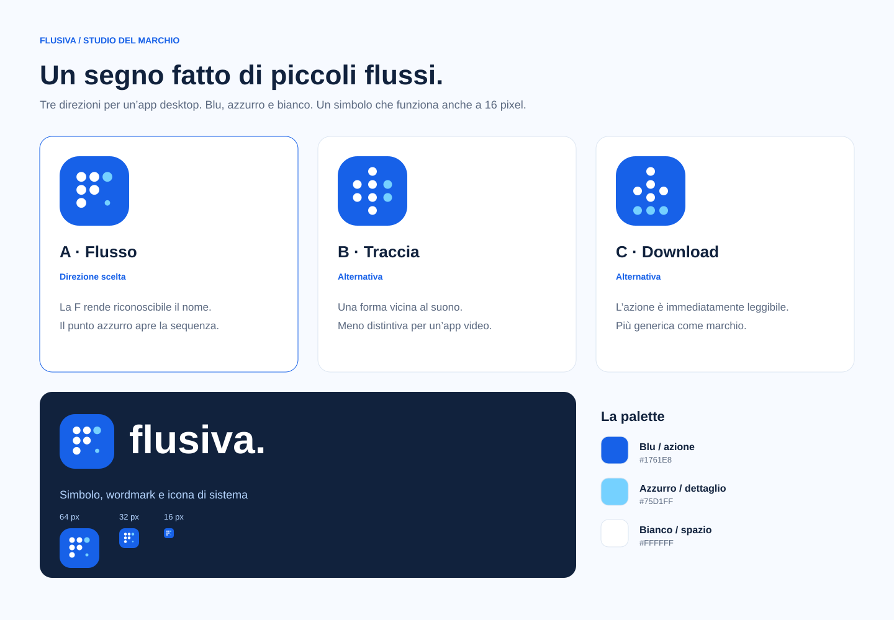

# Studio del logo e identità di Flusiva

## Brief

App desktop essenziale per salvare video e audio, inizialmente da YouTube. Il nome deve restare utilizzabile con altre piattaforme. Richiesta del proprietario: blu, azzurro, bianco e puntini. Il segno deve funzionare nella barra delle applicazioni, nel Dock, nella finestra e negli installer.

## Direzioni esplorate

| Direzione | Idea | Punti forti | Limite | Esito |
| --- | --- | --- | --- | --- |
| A — Flusso | F composta da punti; due accenti azzurri suggeriscono una sequenza aperta | Collega il segno al nome, funziona su audio e video, silhouette leggibile in piccolo | A 16 px usare sempre l’icona completa su fondo blu | Scelta per la prima release |
| B — Traccia | Punti organizzati come un equalizzatore | Associazione immediata all’audio | Meno specifica e sbilanciata verso MP3 | Conservata come alternativa |
| C — Download | Freccia e vassoio costruiti con punti | Comunica l’azione | Simile a molti strumenti di download | Conservata come alternativa |

La scelta è una valutazione progettuale, non il risultato di un test con utenti o di una ricerca di anteriorità del marchio. Il nome Flusiva è stato scelto nella conversazione e adottato nella repository del proprietario.

## Sistema scelto

* **Blu `#1761E8`**: icona, pulsante principale, selezione e focus. Bianco sul blu per le azioni.
* **Azzurro `#75D1FF`**: punti di dettaglio e variazioni del simbolo; non per testo piccolo su bianco.
* **Bianco `#FFFFFF`**: superficie di lavoro. Fondo generale `#F7FAFF`.
* **Inchiostro `#11223D`**: titoli e testo. Secondario `#5B6980`.
* **Wordmark**: minuscolo, peso sostenuto, spaziatura compatta e punto finale blu. Font di sistema per evitare richieste di rete. Il wordmark SVG mantiene testo editabile; la resa può variare leggermente se manca Segoe UI.
* **Puntini**: elementi statici, usati nel simbolo e nella breve traccia sopra il titolo. Nessun lampeggio o loop distraente.

## Regole pratiche

Usare il simbolo su fondo blu; mantenere almeno un diametro del punto di margine libero intorno al marchio. Non ruotare, deformare, aggiungere ombre al simbolo o modificare le posizioni dei punti. Non usare marchi YouTube o TikTok dentro il logo: l’identità deve restare indipendente dalla piattaforma.

Per il Dock e le icone di sistema usare PNG/ICO, generati dal simbolo; per documentazione e stampa usare SVG. A 16 px il punto decorativo piccolo può diventare meno visibile: la F deve restare l’elemento principale.

## File consegnati

* [Simbolo SVG](brand/flusiva-symbol.svg)
* [Wordmark scuro SVG](brand/flusiva-wordmark.svg)
* [Wordmark bianco SVG](brand/flusiva-wordmark-white.svg)
* [Tavola di studio SVG](brand/logo-study.svg)
* [PNG app 512 px](../build/icon.png)
* [ICO Windows](../build/icon.ico)

Riproduzione: `node scripts/brand-assets.mjs` e `node scripts/icons.mjs`. Nessun servizio di generazione immagini, font esterno o asset stock necessario.
