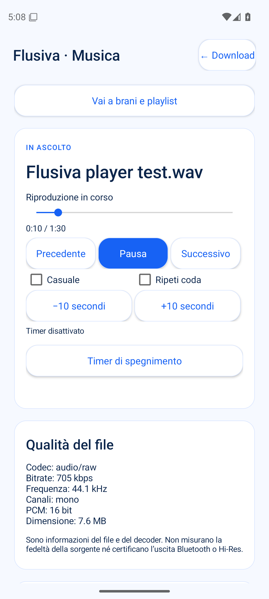
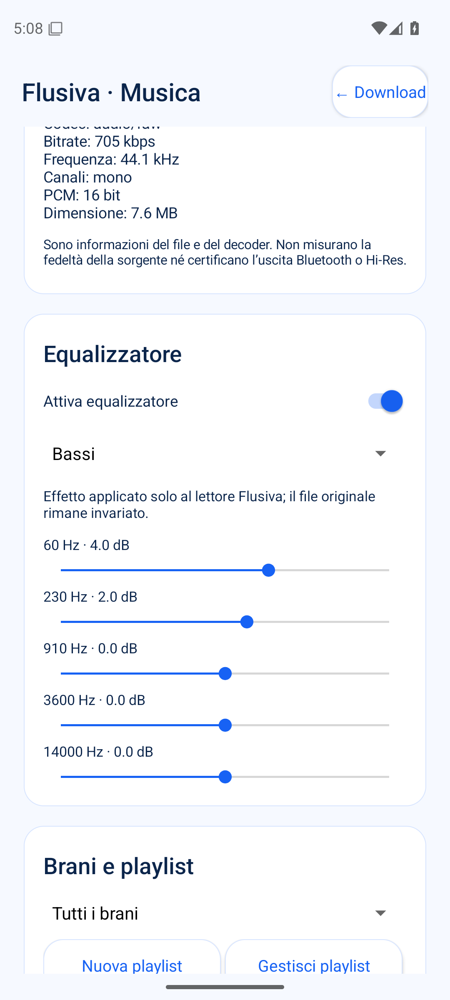
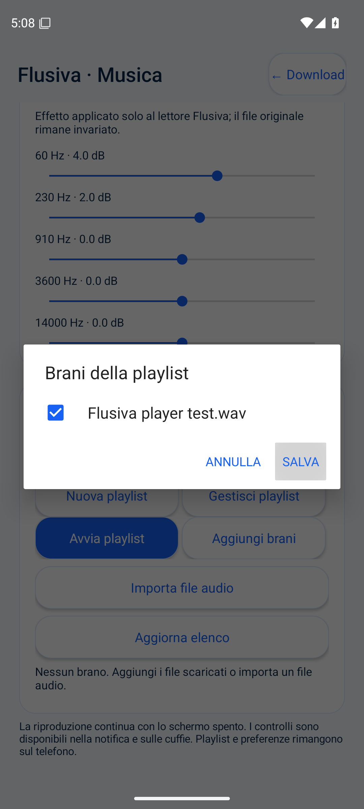

# Lettore musicale Android

Da **Flusiva 0.6.0 per Android**, aprire **Musica e playlist** dalla schermata principale oppure **Ascolta in Flusiva** dopo un download. Il lettore usa AndroidX Media3 1.11.1 e riproduce i file sul telefono, senza caricarli su un servizio Flusiva. Questa funzione è per Android; la versione desktop mantiene le proprie funzioni di download.

 

## Brani e ascolto

La libreria elenca i file audio creati da Flusiva in Download/Flusiva. **Importa file audio** permette di scegliere altri file con il selettore Android, senza chiedere accesso generale alla memoria. Il selettore deve concedere un accesso permanente al file. MP3, AAC/M4A, FLAC, Ogg/Opus e WAV dipendono dai decoder disponibili sul dispositivo. Il lettore può anche ascoltare la traccia audio di un MP4 aperto da un download.

Controlli: riproduci/pausa, posizione nel brano, salti di 10 secondi, precedente/successivo, ordine casuale e ripetizione della coda. Il timer interrompe l’ascolto dopo 10, 30 o 60 minuti ed è annullabile. I tasti volume del telefono regolano il volume multimediale.

La riproduzione continua quando si passa a un’altra app o si spegne lo schermo. Android mostra una notifica multimediale con i controlli; sono utilizzabili anche i pulsanti delle cuffie. Il servizio gestisce la perdita del focus audio e lo scollegamento delle cuffie. Rimuovendo la schermata dalle app recenti l’ascolto può continuare; **Arresto forzato** dalle impostazioni Android termina il programma.

## Playlist persistenti

1. Aprire **Vai a brani e playlist** e scegliere **Nuova playlist**.
2. Inserire un nome, poi usare **Aggiungi brani** per selezionare i file della libreria.
3. Premere **Avvia playlist**, oppure toccare un brano per iniziare da quello.

**Gestisci playlist** permette di modificare i brani, rinominare o eliminare la playlist. Tenendo premuto un brano si può spostarlo prima/dopo o rimuoverlo. Eliminare una playlist o rimuovere un riferimento non elimina i file audio. La modifica di una playlist salvata si applica quando la si avvia nuovamente; la coda già in ascolto rimane quella avviata.

Fino a 50 playlist, con massimo 500 riferimenti per playlist. I riferimenti sono URI locali `content://`, salvati in JSON nelle preferenze dell’app, senza database e senza duplicare i file. Nome e ordine rimangono dopo la riapertura e gli aggiornamenti dell’app. Disinstallazione o cancellazione dei dati dell’app rimuovono le playlist; spostare o cancellare un file può rendere il relativo riferimento non più accessibile.

## Qualità del file

La scheda mostra codec/MIME audio, bitrate, frequenza di campionamento, numero di canali, dimensione e, quando disponibile per PCM, profondità in bit. Durante l’ascolto mostra anche il nome del decoder realmente inizializzato.

Un dato assente viene indicato come non disponibile. Per un file che contiene anche video, il bitrate totale del contenitore non viene presentato come bitrate audio. Non viene attribuita una profondità in bit alla sorgente MP3/AAC soltanto perché il decoder produce PCM.

Questi dati descrivono il file e il decoder: non misurano la fedeltà rispetto alla registrazione originale e non certificano uscita Bluetooth, DAC, Hi-Res, loudness, distorsione o qualità delle cuffie. Un MP3 a 320 kbps può derivare da una sorgente già compressa.

## Equalizzatore

L’equalizzatore Android viene collegato soltanto alla sessione audio del lettore Flusiva. Numero di bande, frequenze e limiti di guadagno vengono letti dal dispositivo. Sono disponibili i preset **Neutro**, **Bassi**, **Voce**, **Brillante** e la regolazione manuale; il guadagno è mostrato in dB. Impostazioni e guadagni vengono conservati localmente.

Il comando agisce sull’ascolto, senza ricodificare o modificare il file. Non ricostruisce dettagli persi nella sorgente. Se il dispositivo o la sessione non rendono disponibile l’effetto, Flusiva lo segnala e disabilita i controlli; il lettore rimane utilizzabile. Non è richiesto il permesso del microfono e non vengono mostrate forme d’onda o misure audio simulate.

## Verifica tecnica

Test JVM per ordinamento e validazione playlist, nomi, preset e limiti del dispositivo. Il test su emulatore crea un WAV sintetico, verifica i dati audio e la persistenza delle playlist, avvia la riproduzione Media3, esegue un seek, prova equalizzatore e timer se disponibili, rilascia i controller della schermata e verifica che l’ascolto continui in background. Infine verifica pausa, passaggio al brano successivo e cancellazione della playlist senza cancellare il file.

Restano necessarie prove su telefoni fisici, diverse implementazioni audio, cuffie Bluetooth e limitazioni energetiche dei produttori. [Guida Android](ANDROID.md), [documentazione Media3](https://developer.android.com/media/media3/session/background-playback) e [API Equalizer](https://developer.android.com/reference/android/media/audiofx/Equalizer).
